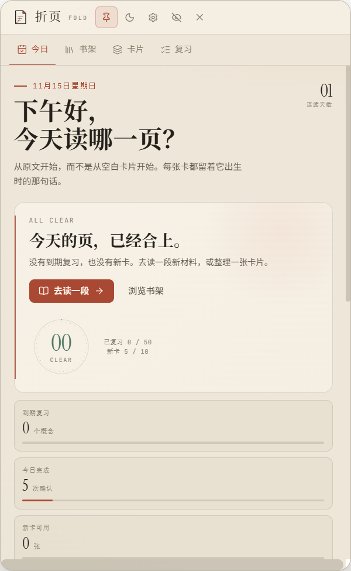

# 折页 FOLD

> 新的默认入口是[引导式离线学习](docs/GUIDED-LEARNING-NEXT.md)：连接自己的 DeepSeek，输入想学的科目，核对折页提供的资料，生成首节后离线学习。不预装课程。下方「原有工作台」保留旧数据和功能的历史操作说明。

## 仓库状态

本仓库沿用 `says693/tack` 的地址和提交历史，当前代码为折页 FOLD。旧版 tack 的代码可从历史提交查看，不与当前程序混装，也不自动迁移旧数据库。

当前是开发候选版本，仅同步源码、文档与测试，不发布 Release 或上传安装包。新向导的真实模型生成仍待端到端验收，不应将旧版验收记录当作新版验收结果。

GitHub Actions 只进行 Windows 构建和测试，不创建版本标签、Release 或上传安装包。旧版三平台自动发布工作流已移除；macOS / Linux 目前未验证。

## 原有工作台

旧版工作台以阅读和卡片管理为中心，流程是：

**选中原文 → 保存引用与定位 → 开一个临时分叉 → 把解释收成草稿 → 你确认后启用 → 独立作答 → 看反馈并自己评级 → 确认后才写入下一次到期日。**

下述真实模型验收属于旧版工作台，不代表新向导已实测真实生成。macOS / Linux 未验证。



## 现在能做什么

| 能力 | 实现 |
| --- | --- |
| 阅读与选区 | Markdown / 纯文本导入、外部片段、UTF-16 逐字定位、来源修订（R1/R2…） |
| 原文回链 | 卡片证据绑定来源修订与偏移，点击“定位原文”回到对应版本并标出位置 |
| 临时分叉 | 从选区创建线索，保留父会话、原文与阅读位置；可再次打开、继续追问、再分叉 |
| 卡片草稿 | 模型或手写生成一张基础问答卡；编辑题目、答案、证据与题源类别 |
| 收下与修订 | 草稿收下才进入队列；启用卡编辑产生新修订；语义变化必须选择保留或重置排期 |
| 主动回忆 | 作答前不展示答案；首次答案不可改写；提示与练习附属于同一次尝试 |
| AI 反馈 | 严格校验判定、要点、错步、提示与证据引用；证据不足不排期 |
| 人工自评 | 明确声明自评模式，不调用模型；AI 失败后必须由用户选择才能切换 |
| 异议 | 对反馈提出异议，记录保留；未确认前不改 due |
| 今日队列 | 概念级调度，默认 10 个新概念 / 50 个到期复习；真实 due 不推迟、不摊平 |
| 持久化 | 本地 SQLite；重启恢复；重复确认幂等；流式中断标识为失败而不编造结论 |
| 导出 | Anki 兼容 TSV（三字段）与含出处/修订/复习历史的 JSON；不导出 API Key |
| 隐私 | 首次云端调用前展示模型、Base URL 与发送范围；失败不静默换模型 |

## 界面

单窗口，五种尺寸：

- 胶囊 `212 × 58`：今日到期或新卡可用数量。
- 面板 `480 × 780`：今日、书架、卡片、设置入口。
- 全景 `1220 × 800`：阅读、分叉线程、证据三栏。
- 复习 `560 × 800`：独立作答、反馈、评级。
- 设置 `860 × 820`：模型、学习、外观、数据、隐私五个分类；窄窗改为横向分类。

标题栏可以切到胶囊；托盘可重新打开；全局快捷键默认 `Ctrl+Shift+Space`。

普通设置入口打开「学习」；首次导览及模型相关操作直接打开「模型」。切换分类保留未提交的设置。外观页和标题栏共用同一个纸色／墨色选项。见[设置设计与实机图](docs/SETTINGS-DESIGN.md)。

## 技术栈

- Tauri 2（Rust）+ React 19 + TypeScript + Vite 8
- Zustand 状态管理
- rusqlite / SQLite（WAL）
- 自研简化 SM-2 调度器 `fold-sm2e-1`，评级 0–3
- 模型：任何 OpenAI 兼容 `/chat/completions` 端点，显式配置
- Markdown 渲染：markdown-it + DOMPurify
- 浏览器预览：`src/mock/backend.ts` 的内存/localStorage 后端，界面明确标注“演示模型 / 模拟批改”，不代表真实学习记录

没有 Python sidecar，没有第二套数据库，没有从竞品迁移数据。

## 快速开始

前置：

- Node.js 24 LTS（与 CI 一致）
- Rust stable 与 Cargo（使用仓库中的 Cargo.lock）
- Windows：WebView2 Runtime、Visual Studio C++ Build Tools
- 首次构建需要能访问 crates.io 或使用镜像

```powershell
npm install
npm run tauri:dev
```

浏览器开发预览，不输入真实 Key、不连接模型：

```powershell
npm run dev
# 打开 http://127.0.0.1:1420/
# 旧版工作台回归另用 ?legacy=1
```

生产构建：

```powershell
npm run tauri:build      # Windows 裸 EXE：src-tauri/target/release/fold.exe
npm run tauri:installer  # 中文 NSIS 安装包：src-tauri/target/release/bundle/nsis/
```

> 仓库里的 `src-tauri/.cargo/config.toml` 是为当前网络环境准备的 rsproxy 镜像与空代理配置。若你的网络可以直接访问 crates.io，可以删除该文件或按需调整。

## 旧版模型配置

旧版工作台从「设置 → 模型 → 获取 DeepSeek API Key」查看图文说明。这和引导式学习的连接流程分别使用各自的凭据；旧配置仍有下述明文存储限制。新用户请从启动向导连接而非旧版设置。

教程图片来自 [DeepSeek 中文官方文档](https://api-docs.deepseek.com/zh-cn/)和折页 Windows 客户端的实际画面。开放平台 API Keys 管理页只提供官方入口，没有使用登录后画面的模拟截图；两张图都不包含密钥。

在“设置 → 模型连接”里填写：

- Base URL，例如 `https://api.example.com/v1`（末尾不带 `/`）
- 模型名
- API Key

预设只负责填入起点；自定义端点不会被标成 DeepSeek 或其他预设。密钥保存在本机 SQLite 的 `settings` 表，**没有做系统钥匙串加密**；导出、日志、提示词和界面都不会回显完整密钥。首次发送原文、答案或对话前，会显示本次发送范围并要求确认。

模型调用失败时：

- 保留用户输入和首次答案
- 显示具体错误
- 不自动切换模型或自评
- 只有用户明确点击“改为自评”才切换，并保留原失败记录

### 真实模型验收

真实模型测试默认忽略，必须显式提供环境变量：

```powershell
$env:FOLD_REAL_BASE_URL = 'https://your-endpoint/v1'
$env:FOLD_REAL_MODEL = 'your-model'
$env:FOLD_REAL_API_KEY = '...'

cargo test --manifest-path src-tauri/Cargo.toml real_model_end_to_end -- --ignored --nocapture
```

它会实际走：连接测试 → 流式对话 → 严格出卡 → 收下 → 入队 → 作答 → 严格批改 → 确认排期 → 重复确认幂等 → 历史 → TSV 导出。

本次验收使用的模型是 `deepseek-v4.1-flash`，输出摘要见 `docs/evidence/real-model-e2e.log`。密钥没有写入仓库、日志或导出。

## 数据与隐私

默认数据目录由 Tauri 的 `app_data_dir` 决定；测试或便携运行可以覆盖：

```powershell
$env:FOLD_DATA_DIR = 'H:\path\to\fold-data'
```

目录里包括：

- `fold.db` + WAL/SHM
- 用户选择的导出文件
- 设置里的模型配置（含 API Key）

本地优先：

- 阅读、手写卡片、自评复习不需要模型。
- 只有对话、自动出卡与 AI 批改会把范围内的内容发到你配置的 Base URL。
- 不扫描其他应用的凭据，不读取浏览器密码库。
- 来源、消息、模型回复都按不可信数据处理；源码文本按纯文本显示，Markdown 经过 DOMPurify，HTML 关闭。
- 删除来源采用软删除：原文归档、相关卡片暂停并显示“来源已删除，等待重新定位”，历史复习记录保留。

## 调度规则

- 调度器标识：`fold-sm2e-1`
- 评级：`0` 忘记、`1` 困难、`2` 正确、`3` 轻松
- 概念级：同一概念的多个当前卡只形成一个到期任务
- 默认预算：每天 `10` 个新概念、`50` 个到期复习概念，可在设置里修改
- 真实 due 不被“摊平”；超出预算只显示积压
- 同一概念同一天最多产生一条已确认复习；第二次尝试会保留为历史但拒绝重复排期
- 语义编辑启用卡会暂停新版，必须选择“保留原排期”或“重置该概念排期”
- 重复确认使用持久化幂等键；同键同负载返回原结果，同键不同负载拒绝

## 目录

```
src/
  App.tsx                 壳、路由、事件与快捷键
  store.ts                Zustand 状态、窗口模式、云端同意
  components/             胶囊、标题栏、编辑器、弹窗、演示坞
  screens/                今日、书架、阅读、线索、全景、复习、卡片、设置
  lib/                    API 包装、选区、格式化、Markdown、文件
  mock/backend.ts         浏览器演示后端
  styles/                 墨色/纸色主题与全部界面样式
src-tauri/
  src/commands.rs         Tauri IPC
  src/db.rs               schema、设置、时间
  src/llm.rs              模型客户端、严格 JSON 与证据校验
  src/scheduler.rs        fold-sm2e-1
  src/repo/               来源、会话、卡片、队列、复习、导出
  src/real_model_test.rs  可选的真实模型 E2E
docs/
  ACCEPTANCE.md           A00–A36 验收记录
  evidence/               截图、测试日志、导出样例
e2e/
  demo-loop.spec.ts       浏览器演示：入门 → 复习 → 反馈 → 确认
```

## 测试

```powershell
npm test              # Vitest：11 个前端单元测试
npm run typecheck     # TypeScript
npm run build         # 前端生产构建
cargo test --manifest-path src-tauri/Cargo.toml --no-default-features
npm run test:e2e      # Playwright，使用系统 Edge，不下载浏览器
```

当前结果：

- Rust：`31 passed`，其中 1 个真实模型测试默认忽略；真实模型运行单独通过。
- 前端单元：`11 passed`。
- Playwright：`1 passed`（浏览器演示闭环）。
- `npm run typecheck` / `npm run build`：通过。

## 验收与未完成

完整逐项记录见 [`docs/ACCEPTANCE.md`](docs/ACCEPTANCE.md)。

需要明确保留的边界：

- **A32 的“至少 5 个概念、20 次真实尝试”尚未完成。** 单次端到端真实模型闭环已通过；跨日、多概念、多尝试的真实试用需要连续使用几天，不能用模拟记录冒充。
- 当前只在 Windows 11 验证；macOS / Linux 未测试。
- MVP 不包含 PDF 导入、OCR、图片遮挡、完整 Anki 排期迁移、云同步和账号系统。
- TSV 已通过兼容解析器与单元测试验证字段完整性，但没有在真实的 Anki 客户端里执行导入。
- API Key 存在本机 SQLite 中，未接入 Windows Credential Manager；请不要在共享电脑上保存生产密钥。
- 浏览器演示的“模型反馈”是模拟输出，界面已标注，不能作为学习效果或真实进度的证据。

## 许可证与依赖

本项目未主动引入 AGPL/GPL 依赖；发布前仍应执行一次依赖许可证审计。字体、图标与运行时依赖遵循各自上游许可证。
